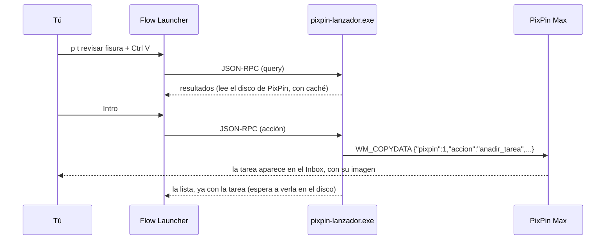

# PixPin Max para Flow Launcher

Plugin de [Flow Launcher](https://www.flowlauncher.com/) para
[PixPin Max](https://github.com/1xmanMAX/PIXPIN_PRO_WINDOWS): busca y usa PixPin sin abrirla.
Escribe **`p`** y lo que quieras hacer.

- Buscar en todo: proyectos, mensajes, lienzos, notas, archivos, audios, capturas y lecciones.
- Apuntar, marcar, mover y quitar tareas, y borrar listas, sin salir de Flow.
- Escribir en el chat de un proyecto, crear notas y lienzos, grabar, capturar.
- Pegar imágenes y archivos con `Ctrl V` (aparecen como `[img 01]` y `[archivo 01]`).
- **Enviar una foto al móvil** (`p m`): pegas la imagen, eliges un aparato de tu grupo de
  sincronización y aparece en el lienzo que tengas abierto en PixPin Android, sin abrir
  Sincronizar. Hace falta PixPin Android con soporte para recibir fotos al lienzo; si el móvil
  aún no lo tiene, PixPin te lo dice y ofrece el envío de siempre.

## Uso

```
p                               → funciones y últimos proyectos
p t comprar sellador [img 01]   → tarea al Inbox, con la imagen pegada (Ctrl V)
p tareas                        → todas las listas de tareas
p tareas Compra > yogur         → dentro de la lista «Compra»: filtrar o añadir «yogur»
p Tesis > texto                 → escribir en el chat del proyecto «Tesis»
p n idea para la tesis          → nota nueva
p l plano                       → lienzo nuevo
p g muro                        → buscar en la galería (también por el texto de dentro)
p c                             → capturar una zona
p u                             → pinear la última captura
p a revisar la escala           → lección aprendida nueva
p lecciones grietas             → buscar lecciones
p cualquier cosa @Tesis         → buscar, solo en ese proyecto
p m [img 01]                    → enviar la imagen al lienzo abierto del móvil (elige el aparato)
```

En una tarea, **Intro** la marca como hecha (o la desmarca). El menú contextual de una tarea
(`Mayús Intro` o clic derecho) ofrece moverla a otra lista y **quitarla**; el de una lista,
**borrarla** entera.

## Cómo funciona



- **Para leer**, el plugin no necesita la app: lee los proyectos de PixPin Max directamente del
  disco (`%APPDATA%\PixPinMax`, o la carpeta del modo portable), con una caché que solo relee
  lo que cambió.
- **Para cambiar algo**, le manda un pedido a la app (`WM_COPYDATA`), que es quien escribe. Si
  la app no está abierta, la abre. El protocolo está en
  [`docs/protocolo-pedidos.md`](docs/protocolo-pedidos.md): cualquier programa puede usarlo.
- Flow arranca el plugin una vez por tecla, así que el exe es pequeño y rápido: no carga nada
  de la app, y `user32.dll` se carga solo cuando hace falta.

## Instalar

Requisitos: Windows 10/11, [Flow Launcher](https://www.flowlauncher.com/),
[PixPin Max](https://github.com/1xmanMAX/PIXPIN_PRO_WINDOWS) y
[Rust](https://rustup.rs/) (la versión se fija sola con `rust-toolchain.toml`).

```powershell
git clone https://github.com/1xmanMAX/PIXPIN_PRO_PLUGIN_FLOWLAUNCHER.git
cd PIXPIN_PRO_PLUGIN_FLOWLAUNCHER
powershell -ExecutionPolicy Bypass -File instalar.ps1
```

`instalar.ps1` compila el plugin, lo copia a `%APPDATA%\FlowLauncher\Plugins\PixPin Max\`,
pone la palabra clave `p` y vuelve a abrir Flow.

## Compilar y probar

```powershell
cargo build --release -p pixpin-lanzador
cargo test -- --test-threads=1
```

## Estructura

| Carpeta | Qué hay |
|---|---|
| `pixpin-lanzador/src` | El plugin: consulta, resultados, menús, caché del disco y pedidos |
| `pixpin-lanzador/plugin` | `plugin.json` e icono, lo que se copia a Flow |
| `pixpin-lecciones` | Las lecciones aprendidas: leer, buscar y repaso espaciado, igual que la app |
| `docs/protocolo-pedidos.md` | El protocolo para pedirle cosas a PixPin Max |

El código se desarrolla dentro de
[PIXPIN_PRO_WINDOWS](https://github.com/1xmanMAX/PIXPIN_PRO_WINDOWS)
(`apps/pixpin-lanzador` y `crates/pixpin-lecciones`) y se copia aquí.

## Licencia

MIT. Ver [LICENSE](LICENSE).
